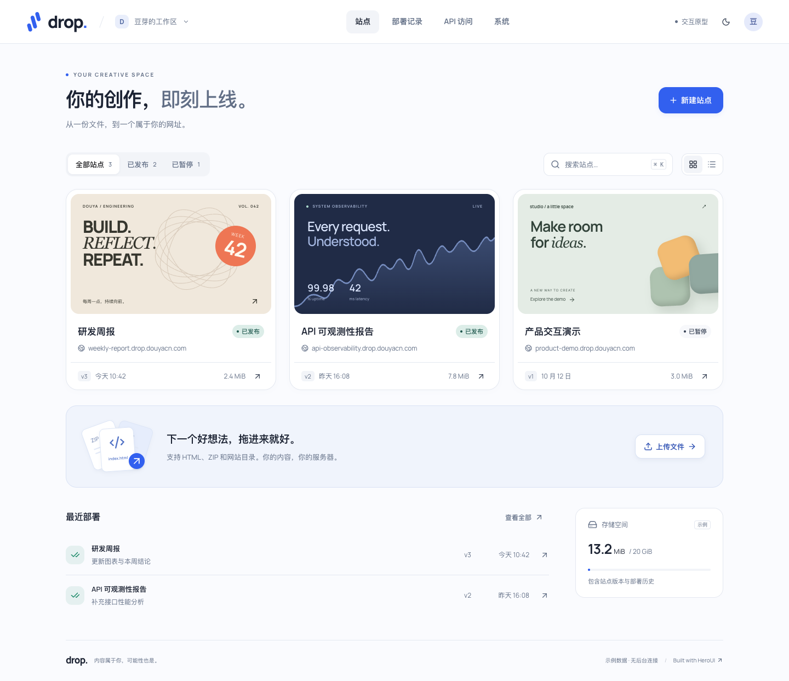

# Self-hosted Drop

## 目录

- [1. 项目与功能](#1-项目与功能)
- [2. 本地启动](#2-本地启动)
- [3. 自动上传](#3-自动上传)
- [4. 开发与验证](#4-开发与验证)
- [5. 文档与边界](#5-文档与边界)

## 1. 项目与功能

用自己的服务器发布 HTML 和静态网站。后端使用 Go，前端使用 React、HeroUI、TypeScript；PostgreSQL 保存站点和任务，Caddy 直接提供已发布的不可变文件。

- 上传 HTML、ZIP 或浏览器选择的网站目录，检查入口、本地资源和外部依赖。
- 检查完成后确认发布；公开网址保持不变，历史版本可回滚、固定保留和导出。
- 一次性预览链接、独立预览 Cookie、逐请求鉴权；暂停或删除站点立即撤销预览。
- 单管理员登录、CSRF 防护、按站点与操作限定的 API Token。
- 暂停/恢复、回收站、保留策略、磁盘预留、审计和加密备份维护命令。
- 深浅主题、响应式布局、真实上传进度、后台任务轮询和发布操作状态。

目标地址：后台 `drop-admin.douyacn.com`，公开站点 `{slug}.drop.douyacn.com`，预览 `d-{deploymentId}.drop.douyacn.com`。本地使用 `.localhost`，项目不会自动修改 DNS 或现有代理。



图中为界面设计样例；运行应用的数据来自数据库。站点封面是装饰图案，未执行或截图用户上传的页面。

## 2. 本地启动

需要 Docker Engine 与支持 volume `subpath` 的 Docker Compose v2，以及 Python 3。容器会运行 PostgreSQL、Go 管理服务、独立处理 worker 和 Caddy。

```bash
python3 scripts/init-secrets.py
cp .env.example .env
docker compose up -d --build
```

打开 [本地管理后台](http://localhost:18180)。首次访问输入 `.secrets/setup.key` 文件中的初始化凭据，然后设置至少 12 个字符的管理员密码。凭据文件不得提交到 Git。

```bash
# 在本机终端读取初始化凭据，仅用于首次设置。
cat .secrets/setup.key
```

发布后的本地网址形如 `http://my-report.drop.localhost:18080`。Chrome 支持 `.localhost`；若某客户端不能解析，可通过本地 hosts/DNS 解析至 `127.0.0.1`。

```bash
# 查看状态与日志。
docker compose ps
docker compose logs --tail 100 app worker

# 核对数据库、正式路由、文件/内容，以及待处理发布和期望状态漂移。
docker compose exec -T app drop-entrypoint drop doctor

# 遇到未知发布状态时只读检查；核验后的恢复步骤见运行与部署手册。
docker compose exec -T app drop-entrypoint drop reconcile "<publication-id>"

# 停止服务并保留数据卷。
docker compose down
```

正式接入 `douyacn.com` 前请执行[运行与部署手册](docs/运行与部署.md)中的 HTTPS、Host 转发、Cookie 和恢复检查。默认 Compose 仅将后台和公开内容端口绑定至本机回环地址。

`reconcile` 默认只读，报告目标/已应用配置匹配情况与当前配置哈希。已观测到完整目标配置时可选 complete；恢复已应用基线时选 restore-applied。两个写入模式均需刚读取的哈希与完整核验，未确认结果保持全局阻断；complete 可在重新检查后退回 restore-applied，已选恢复基线时不能反向完成原目标。命令见运行与部署 4.2 节。

## 3. 自动上传

先在后台创建站点，再创建至少包含 `sites:read`、`deployments:write` 的站点级 Token；自动发布另需 `publications:write`。

```bash
# DROP_TOKEN 由环境或 CI secret 提供；不把明文写进脚本或仓库。
export DROP_URL=https://drop-admin.douyacn.com
python3 scripts/drop-upload.py ./dist.zip --site my-report --publish
```

脚本分块上传并输出 JSON。默认遇到检查警告时停止发布，退出码为 `4`；确认依赖后才使用 `--allow-warnings`。多入口 ZIP 可传 `--root dist --entry index.html`，SPA 使用 `--mode spa`。

同一文件和元数据默认复用上传幂等键，终态也会返回原 Deployment。显式使用 `--retry-failed` 时，脚本只有观察到 FAILED/CANCELED 才以新键尝试一次；该选项不能与 `--idempotency-key` 同用。连接中断或结果未知时保留错误 JSON 中的 `idempotencyKey` 重试，不自动创建下一次尝试。发布请求的键另包含站点 generation，脚本最终以 Publication 的 APPLIED 为成功依据。

暂停站点拒绝普通发布、回滚和自动发布。恢复需 `sites:manage` 权限；旧版本不可用或没有旧正式版本时，管理员可在暂停站点的 READY 历史版本上明确选择“以此版本恢复服务”，确认检查报告与警告后等待恢复 Publication 的 APPLIED。

完整接口见 [OpenAPI 3.1](api/openapi.json) 和[实现与验收说明](docs/实现与验收.md)。

## 4. 开发与验证

本机开发需要 Go 1.27、Node.js 22、npm、Python 3 和 Docker。

```bash
make build
python3 scripts/dev-bootstrap.py
python3 scripts/dev.py
```

在另一个终端执行 `npm --prefix web run dev` 可使用前端 HMR；Go 服务默认监听 `18180`。两种开发入口共用本地数据库。原生开发凭据在 `.local/`，与 Compose 的 `.secrets/` 独立。

```bash
go test -race ./...
go vet ./...
npm --prefix web run build

# 仅对本地测试栈运行，会创建临时站点并移入回收站。
python3 tests/integration.py \
  --password-file /path/to/local-test.password \
  --setup-key-file .local/setup.key

# 独立浏览器用户目录，不复用日常浏览器会话。
DROP_TEST_PASSWORD_FILE=/path/to/local-test.password \
  npm --prefix web run test:browser
```

CI 执行 Go 测试、前端构建、全新 Compose 安装、API 集成、浏览器操作和重启后的 `doctor`。测试数据与本机运行文件均被 `.gitignore` 排除。

## 5. 文档与边界

- [运行与部署](docs/运行与部署.md)：配置、存储、域名入口、备份恢复、升级与常见问题。
- [实现与验收](docs/实现与验收.md)：实现范围、代码模块、验证证据和待完成项。
- [开发设计 v1](docs/self-hosted-drop-开发设计-v1.md)：目标架构、状态机、P0 验收要求。
- [原始 PRD v1.1](docs/self-hosted-drop-prd-v1.1.md)：保留原文的需求依据。
- [前端组件说明](docs/frontend-components.md)：组件来源与原型。
- [离线原型](docs/ui-preview.html)：设计参考；实际应用源码位于 `web/`。

当前版本为 `0.1.0`，支持单实例管理服务和受信任发布者。它接收已构建的静态文件，不提供服务器端构建或执行。完整 P0 的生产验收仍包含真实域名/TLS 接入、外部入口限流、主机配额与压测、异机恢复和故障注入；具体状态见实现与验收文档。
