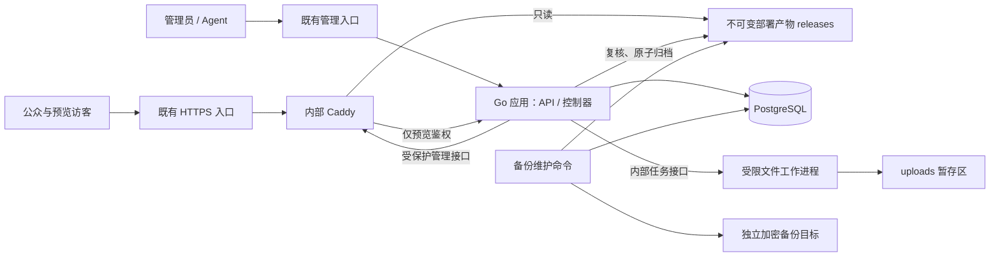
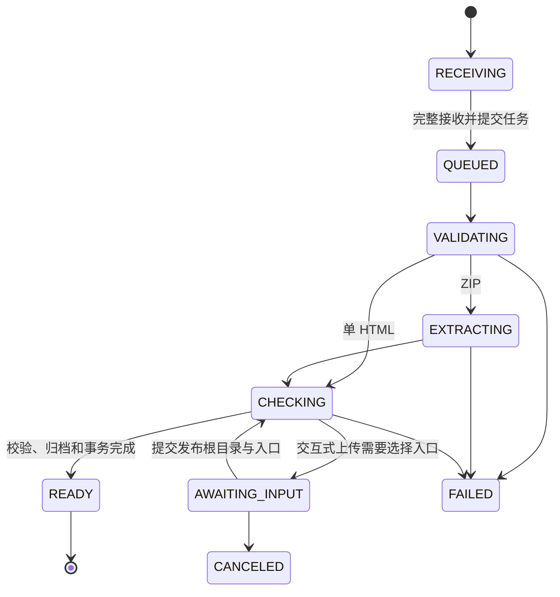
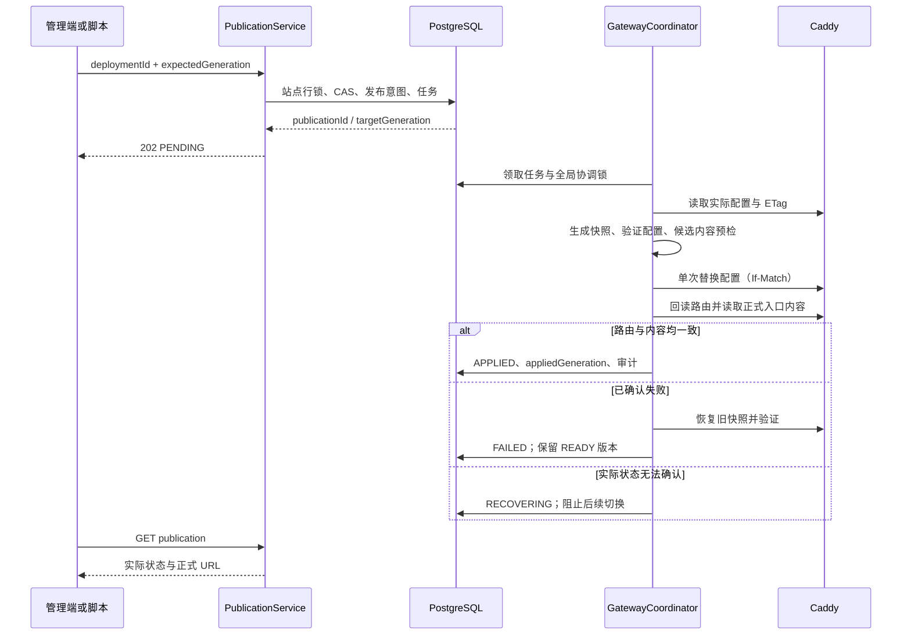
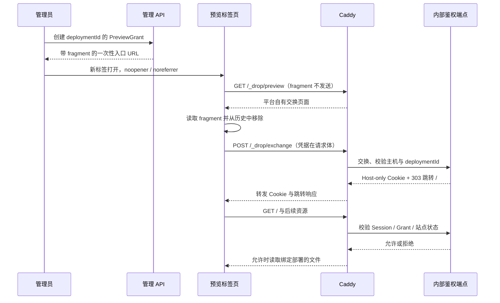

# Self-hosted Drop 开发设计 v1

## 目录

- [1. 文档依据与交付范围](#1-文档依据与交付范围)
- [2. 技术选型与总体架构](#2-技术选型与总体架构)
- [3. 域名与外部入口契约](#3-域名与外部入口契约)
- [4. 工程组织与运行隔离](#4-工程组织与运行隔离)
- [5. 数据模型与数据库约束](#5-数据模型与数据库约束)
- [6. 上传与不可变产物](#6-上传与不可变产物)
- [7. 任务调度与幂等](#7-任务调度与幂等)
- [8. 发布协调与崩溃恢复](#8-发布协调与崩溃恢复)
- [9. 登录授权与受控预览](#9-登录授权与受控预览)
- [10. 管理-api-合约](#10-管理-api-合约)
- [11. 现代化管理界面](#11-现代化管理界面)
- [12. 静态分发与缓存](#12-静态分发与缓存)
- [13. 配额保留与垃圾回收](#13-配额保留与垃圾回收)
- [14. 备份恢复与升级](#14-备份恢复与升级)
- [15. 部署配置与可观测性](#15-部署配置与可观测性)
- [16. 测试策略与验收矩阵](#16-测试策略与验收矩阵)
- [17. 开发工作包与交付顺序](#17-开发工作包与交付顺序)
- [18. 待验证事项与实现边界](#18-待验证事项与实现边界)
- [19. 参考资料](#19-参考资料)

## 1. 文档依据与交付范围

### 1.1 状态与依据

文档日期：2026-10-14。文档状态：**开发设计与目标规范**。当前实现和验收状态见 [实现与验收](实现与验收.md)。

产品依据为 [需求规格说明书 v1.1](self-hosted-drop-prd-v1.1.md)。已确定的方向是 Go 后端、复用 `douyacn.com`、现代化前端。本文的框架组合、表结构、补充 API 和运行参数是建议实现设计，不能视为已经实现或完成实机验收。

目标实施范围为 PRD 的全部 P0：单管理员、受信任发布者、静态产物上传、正式发布、受控预览、回滚、暂停、回收站、自动化 API、配额、审计、备份与恢复。

### 1.2 成功条件

- HTML、ZIP 和目录均进入同一处理链路；上传失败不覆盖当前站点。
- 同一站点更新、回滚、改显示名称后，正式 URL 保持不变。
- READY 表示产物就绪；APPLIED 才表示路由切换及内容校验成功。
- 后台或数据库短时停止时，正式静态站点继续服务；预览无法鉴权时拒绝访问。
- 界面、API 和自动上传脚本复用发布逻辑；完成 PRD AC-01 至 AC-20 的可重复验收。
- 交付物包括源码、锁定依赖、镜像、Compose、OpenAPI、脚本、运维手册及测试记录。

### 1.3 范围约束

服务器仅接收已经构建的静态内容，不提供在线构建、服务端脚本执行或公开匿名上传。P0 不包含正式站点密码保护、多用户、独立产品级 CLI 或 MCP。外部 DNS、HTTPS 入口建设与其他业务代理改造仍由既有环境负责；本文定义接入契约与检查项。

## 2. 技术选型与总体架构

### 2.1 建议技术基线

| 层次 | 采用方案 | 用途与约束 |
|---|---|---|
| 后端 | Go、`net/http`、chi | REST API、流式上传、发布协调、维护命令 |
| 数据访问 | pgx、sqlc、SQL 迁移 | 显式事务和 SQL；不依赖自动建表 |
| 数据库 | PostgreSQL 16 | 元数据、任务、幂等记录、配额和审计 |
| 前端 | React 19、TypeScript、Vite | 浏览器管理应用；构建后由 Go 服务提供 |
| 界面 | HeroUI v3、Tailwind CSS 4、Lucide | React Aria 交互基础、统一组件和项目主题 |
| 前端状态 | TanStack Query、React Router | 服务端状态缓存、轮询、页面路由 |
| 文件服务 | Caddy 2 | 静态文件、预览前置鉴权和配置热更新 |
| 任务 | PostgreSQL 任务表及租约 | 全局处理并发 2；无需 Redis |
| 备份 | pg_dump/pg_restore、restic | 一致快照、独立目标、加密与完整性核验 |
| 部署 | Docker Compose | 一个业务代码仓库，独立容器权限与配额 |

Go 使用实施时仍受支持的稳定版本；M0 锁定补丁版本、依赖版本和镜像摘要。前端产物包含脚本、样式与字体，运行时不依赖第三方字体或脚本 CDN。HeroUI 通过 npm 引入并锁定版本，主题变量与业务组件保存在本仓库；按钮、表单、标签页和弹窗共用一套组件基础。[S8]

选择 Go 的依据是本项目主要处理 I/O、任务和发布状态，公众下载由 Caddy 承担；维护成本优先于业务后端极限性能。这是项目选型判断，不是 Go 与 Rust 的实测性能结论。

### 2.2 运行拓扑



正式内容请求不访问 Go 或数据库。工作进程不能调用 Caddy 管理 API，也不能修改 releases。预览鉴权与管理 API 共用业务代码，但使用独立内部监听地址，不向公网暴露内部授权接口。

### 2.3 业务模块

按配置、认证、站点、上传、检查、部署、发布、预览、配额、回收、备份和审计划分 Go 包。HTTP handler 只负责输入、鉴权和输出；事务与业务约束放入应用服务；文件处理、数据库和 Caddy 访问通过可测试接口封装。

## 3. 域名与外部入口契约

### 3.1 拟用地址

| 类型 | 地址规则 | 访问行为 |
|---|---|---|
| 管理 | `https://drop-admin.douyacn.com` | 管理页面、登录及 `/api/v1` |
| 正式 | `https://{slug}.drop.douyacn.com` | 仅登记且已启用的正式站点 |
| 预览 | `https://d-{deploymentId}.drop.douyacn.com` | 绑定单个部署并逐请求鉴权 |

内容使用 `*.drop.douyacn.com`；它不要求迁移 `douyacn.com` 下其他服务。初始化校验管理源与内容源不同，slug 禁用 `d-` 前缀及系统保留名。deploymentId 采用服务端生成的 32 位小写十六进制随机 ID，预览主机标签不会超过 DNS 长度限制。

### 3.2 接入条件

既有入口须支持上述主机名、HTTPS、原始 Host 转发、至少 200 MiB 文件载荷及可配置上传超时；代理请求体上限需另外容纳 multipart 元数据。`*.douyacn.com` 的常规通配证书不覆盖 `report.drop.douyacn.com`，内容证书应覆盖 `*.drop.douyacn.com`。[S9]

生产环境 TLS 终止在既有入口；Drop 内部使用受限网络。管理监听和内容监听分别转发，数据库和 Caddy 管理接口不得设置公网映射。未知 Host 返回统一 404，禁止兜底进入管理后台。

公网 DNS 查询只提供瞬时参考：2026-10-14 查到主域 NS 属于 Cloudflare，未查到拟用 Drop 地址的 A 记录；这不证明内部配置未占用，也不证明 HTTPS 和转发能力就绪。DNS only 可以保留 Cloudflare DNS 托管而不让 HTTP 流量经过其代理。[S10]

部署前须检查现有业务是否设置 `Domain=douyacn.com` 的共享 Cookie。不同子域名提供源隔离，但不自动消除同站 Cookie 和 CSRF 风险；后台采用 host-only Cookie 和独立 CSRF 防护。[S3]

## 4. 工程组织与运行隔离

### 4.1 拟建目录

以下为实施时创建的工程结构，不代表这些程序已经存在。

```text
cmd/drop/                  API、控制器与主机维护命令
cmd/drop-worker/           内部任务服务及受限解包子进程
internal/
  config/ auth/ sites/ deployments/ publications/ preview/
  archive/ inspection/ storage/ quota/ jobs/ gateway/
  backup/ audit/ database/ httpapi/
db/migrations/            可追踪的 SQL 迁移
db/queries/               sqlc 输入 SQL
api/openapi.yaml          管理 API 的契约来源
web/src/                  React 管理端及生成的 API 类型
deploy/                   Compose、镜像构建和 Caddy 引导配置
scripts/                  上传、备份、恢复与检查入口
tests/fixtures/           正常站点及恶意上传样例
tests/integration/        PostgreSQL、网关和故障恢复测试
docs/                     需求、设计、操作与验收文档
```

### 4.2 Compose 服务及权限

| 服务 | 可读写内容 | 网络与权限 |
|---|---|---|
| app | uploads、quarantine、releases、runtime；PostgreSQL | 管理入口；可调用 worker 和 Caddy 管理接口 |
| worker | 仅 uploads 中的任务目录 | 无数据库凭据、无 releases 挂载、无网关管理权限 |
| caddy | releases 只读；自身持久化配置可写 | 内容入口；可调用 app 的内部预览鉴权端点 |
| postgres | 专用数据库卷 | 仅应用数据库网络，不映射宿主机公网端口 |
| maintenance | 按需读取数据与备份目标 | 同应用镜像的维护命令，备份凭据单独挂载 |

所有服务使用非 root 身份、只读容器根文件系统、`cap_drop: ALL` 和 `no-new-privileges`；为临时目录单独提供可写挂载。Docker Socket、宿主机 HOME、其他业务数据均不挂载。app 与 worker 共享暂存文件组权限，worker 的挂载树不包含发布区。

worker 接收内部 jobId 后，仅处理服务端登记的暂存任务。每次解包在独立子进程中运行，父进程限制并发、墙钟时间并在取消时终止整个任务进程组；子进程不继承数据库、初始化及备份凭据。内部调用使用专用网络和共享服务凭据，不能通过管理入口转发。

### 4.3 存储布局

```text
/data/uploads/{deploymentId}/payload
/data/uploads/{deploymentId}/attempts/{attemptId}/tree/
/data/quarantine/{deploymentId}/{attemptId}/
/data/releases/{deploymentId}/public/
/data/releases/{deploymentId}/manifest.json
/data/runtime/gateway/snapshots/{gatewayGeneration}.json
/data/runtime/exports/
<独立备份目标>/<backupId>/
```

uploads、quarantine 和 releases 使用同一文件系统；quarantine 只对 app 可写，用于关闭 worker 写入权后的复核。每次处理使用新 attemptId；过期进程无法覆盖新尝试。app 验证结果后 fsync 文件及必要父目录、原子 rename 到 releases，再提交 READY；不能仅依靠 rename 宣称已经具备断电持久性。

Caddy 的站点 root 精确指向某个 `public/`，不指向 releases 根目录。manifest、上传包、导出暂存和网关配置均不能通过站点路径获取。发布后的文件不可原地修改，修复内容必须生成新部署。

## 5. 数据模型与数据库约束

### 5.1 建模原则

PostgreSQL 使用明确的关系表、外键、唯一约束和事务。状态使用 text 与 CHECK 约束，迁移可增补状态；时间统一 timestamptz/UTC，字节计数使用 bigint。仅 warnings、配置快照、manifest 摘要等可变结构使用 JSONB，文件内容不进入数据库。

ID 使用随机 128 位值编码成 32 位小写十六进制。外部 API 使用 camelCase，数据库使用 snake_case。数据库字段及错误详情均不向客户端泄漏宿主机绝对路径。

### 5.2 主要表

| 表 | 核心字段 | 关键约束 |
|---|---|---|
| administrators | id、password_hash、created_at、password_changed_at | P0 只允许一个有效管理员 |
| admin_sessions | id、token_digest、csrf_digest、expires_at、revoked_at | 唯一摘要；退出、改密后撤销 |
| sites | id、slug、name、description、status、desired_status、generation、applied_generation、desired_deployment_id、applied_deployment_id、deleted_at | slug 唯一；name 1–100 字符 |
| deployments | id、site_id、status、artifact_state、input_hash、artifact_hash、root_directory、entry_path、routing_mode、manifest_version、file_count、expanded_bytes、message、error_code、created_by | root/entry/mode 在 READY 后不可变 |
| inspection_reports | id、deployment_id、revision、candidates、warnings、blocking_errors、report_hash | 部署内 revision 唯一；明确扫描版本 |
| publications | id、site_id、deployment_id、action、expected_generation、target_generation、target_status、status、previous_snapshot_id、applied_at、error_code | 站点和 target_generation 唯一 |
| site_routes | host、kind、site_id、deployment_id、site_generation、gateway_generation、applied_at | host 唯一；仅保存平台登记映射 |
| gateway_snapshots | id、generation、config_hash、config_path、status、created_at | 全局 generation 唯一递增 |
| api_tokens | id、name、digest、scopes、expires_at、revoked_at、last_used_at | digest 唯一；默认不允许管理或删除 |
| api_token_sites | token_id、site_id | 联合主键，限制项目范围 |
| preview_grants | id、deployment_id、token_digest、expires_at、redeemed_at、revoked_at | token_digest 唯一；兑换原子且仅一次 |
| preview_sessions | id、grant_id、deployment_id、token_digest、expires_at、revoked_at | 每个请求重新核验授权 |
| jobs | id、kind、resource_id、status、attempt_id、lease_until、heartbeat_at、attempt_count、next_run_at、error_code | 同一业务操作只有一个活动 job |
| idempotency_records | actor_id、site_id、operation、key、request_hash、status、resource_id、expires_at | actor/site/operation/key 联合唯一 |
| quota_reservations | id、deployment_id、reserved_bytes、written_bytes、lease_until | 与任务状态一同更新；禁止负数 |
| artifact_pins | deployment_id、kind、reference_id、expires_at | 当前版本、发布、预览、备份、人工固定均可引用 |
| backup_runs | id、status、snapshot_id、manifest_hash、target、started_at、completed_at | 完成标记与校验结果一致 |
| system_settings | key、value、revision、updated_by、updated_at | 仅允许登记键；更新使用 revision 比较并审计 |
| audit_events | id、actor、action、site_id、deployment_id、request_id、result、created_at | 追加写；索引覆盖时间、站点及 requestId |
| slug_reservations | slug、site_id、reserved_at | P0 删除后不自动将旧地址分配给新站点 |

### 5.3 关系和索引

- `(site_id, id)` 建立部署联合唯一约束；站点当前版本及发布目标通过联合外键约束属于同一站点。
- 部署历史索引 `(site_id, created_at DESC, id)`；站点筛选使用状态及名称/slug 索引。
- 可领取任务使用 `(status, next_run_at, lease_until)`；过期会话、幂等记录及回收任务建立时间索引。
- Publication 的 PENDING/APPLYING/RECOVERING 对每站点建立部分唯一约束；不能同时存在两个未决切换。
- 文件 manifest 放磁盘，以排序后的相对路径、大小、SHA-256 和媒体类型构成；数据库仅保存位置标识、计数、总字节和摘要。

### 5.4 状态与版本字段



AWAITING_INPUT 是对 PRD 的补充设计，解决“服务端识别后需要用户选择”的闭环。严格 API 模式不等待交互：入口不明确时以 ENTRY_SELECTION_REQUIRED 失败并返回候选项。所有可取消阶段、接收中断及任务超时的终结分支同样必须实现；上图只显示主要路径。

站点对外状态为 DRAFT、ACTIVE、PAUSED、DELETED；desired_status 与实际 status 分离。generation 在接受切换意图时递增，applied_generation 在验证生效后更新；失败不回退或复用 generation。部署显示“当前正式”由站点引用推导，不能再增加与 READY 混用的 ONLINE 处理状态。

## 6. 上传与不可变产物

### 6.1 统一输入

上传接口接收 multipart：一个 `metadata` JSON 部分和一个 `file` 部分。metadata 先于文件，最大 64 KiB；文件可以是 HTML/HTM 或 ZIP。服务端按文件签名、扩展名和解析结果校验，不信任浏览器 Content-Type。

浏览器目录选择和拖拽目录先收集相对路径，在 Web Worker 中使用 fflate 的流式 ZIP 接口打包。只处理单个网站根目录，目录与 ZIP 最终进入同一个服务端检查器。客户端校验只改善体验，不能替代服务端限制；不支持目录选择时提供 ZIP 操作提示。

上传使用 XMLHttpRequest 获取字节进度并支持 abort。开始写入前鉴权、检查限流和预留容量；文件以流方式落入暂存区，同时计算 SHA-256。入站文件默认 200 MiB，单 HTML 还受 100 MiB 单文件限制。未知 Content-Length 按最大允许量预留，读取时仍逐字节计数。

完整接收、入站哈希确定、文件持久化且数据库任务提交成功后才返回 202。此时界面显示“传输完成，正在检查”；只有 READY 才表示上传校验完成，APPLIED 才表示正式发布成功。断连保留失败记录并异步回收暂存，不能将部分 payload 视为可重试的成功输入。

### 6.2 安全解包算法

1. 读取 ZIP 目录和标记，拒绝加密、非支持压缩方法及不合理头部；P0 只支持 Store 和 Deflate。
2. 对路径进行 UTF-8、长度、段数和类型验证；统一使用相对 POSIX 路径作为逻辑路径。
3. 拒绝绝对路径、Windows 盘符/UNC、反斜杠、NUL、`.`/`..` 路径段、重复分隔符、符号链接、硬链接、设备文件与其他特殊文件。
4. 检测原始重名、Unicode NFC 等价名、大小写折叠冲突及文件/目录前缀冲突；拒绝冲突，不偷偷覆盖或重命名。
5. 使用 Go `os.Root` 约束文件操作，并在平台路径策略层继续拒绝链接；不能只做字符串前缀判断或“先 realpath 再写入”。[S2]
6. 流式解压并累计实际文件数、实际写入字节、每文件大小与处理耗时；校验 CRC/截断错误，不信任 ZIP 声明大小。
7. 拒绝任何目录中的明确秘密文件；忽略并报告 `.DS_Store`、`__MACOSX` 等无业务元数据。嵌套归档不递归展开。
8. 关闭、同步文件后生成 manifest；app 独立复核清单、文件类型、大小与哈希，才允许移入发布区。

默认限制：解压总量 1 GiB、单文件 100 MiB、文件数 10,000、深度 20、路径 512 UTF-8 字节；单次处理墙钟超时建议 120 秒，可配置。压缩比只作辅助异常指标，实际字节、CPU、内存和超时限制才是强制边界。[S1]

路径的 URL 解码只发生在 HTTP 请求解析层一次；文件清单保留实际 Unicode 文件名，资源引用按标准 URL 解析后匹配。不对 ZIP 路径反复做 percent-decode；含编码分隔符、非法 UTF-8 或模糊规范化结果的请求拒绝处理。

### 6.3 入口与检查结果

| 情形 | 行为 |
|---|---|
| 单 HTML | 保留文件名，正式 `/` 只做内部入口重写 |
| 根目录 index.html | 默认根目录及 index.html |
| 单包装目录 | 给出建议根目录，界面展示确认；严格 API 可按唯一候选自动识别 |
| 多入口、多个 dist | 交互模式进入 AWAITING_INPUT；严格模式返回可定位错误 |
| 无 HTML 入口或仅源码 | ENTRY_NOT_FOUND/SOURCE_NOT_BUILT，不运行构建 |

交互模式通过 `POST /deployments/{id}/selection` 提交 rootDirectory、entryPath、routingMode 和 inspectionRevision。READY 后不再允许修改这些字段，回滚始终恢复目标部署自己的路由配置。

本地引用检查覆盖 script/src、link/href、img/src/srcset、iframe/src、CSS url 和 @import；正确处理相对路径、根路径、query、fragment 和 HTML base。收集静态外链、HTTP 混合内容以及脚本中可识别的 URL 字面量。动态拼接 URL、业务调用成功率和完整 JavaScript 执行行为不作保证。

缺入口、秘密文件、危险路径与超限阻断处理；普通缺资源、HTTP 外链和其他外部依赖生成带 code、文件和位置的警告。服务器不访问这些 URL。报告按扫描器版本、入口配置与结果计算 reportHash；正式发布确认必须绑定该报告，避免确认旧报告后发布不同内容。

### 6.4 READY 的落盘顺序

处理完成的目录包含 `public/` 和清单；manifest 使用规范化相对路径排序，以确定性序列计算 artifactHash。相同目录通过 ZIP 或目录上传，应产生一致的公开文件清单和 artifactHash，原上传包 hash 可以不同。

worker 先关闭写句柄并退出处理子进程，app 确认对应 attempt 已结束，再把结果移到 worker 挂载范围之外的隔离目录。随后 app 复核 → fsync → 同文件系统 rename → fsync 父目录 → 事务写入 READY、实际占用与检查报告。交接后禁止 worker 再打开该结果；不能在仍可被修改的文件上完成校验后直接发布。rename 成功而数据库未提交时，由恢复器验证并补记；没有有效 manifest 的孤儿目录不注册路由。

## 7. 任务调度与幂等

### 7.1 持久化队列

任务使用 `SELECT … FOR UPDATE SKIP LOCKED` 领取，在短事务中记录 attemptId、租约和状态。文件 I/O、解包、Caddy 调用不放进数据库长事务。SKIP LOCKED 只用于队列领取，不用于用户数据的一致性查询。[S6]

建议默认队列上限 20、全局文件处理并发 2、租约 30 秒、心跳 10 秒。队列已满返回 429 QUEUE_FULL 和 Retry-After；同站点正式切换另行串行，不能用上传完成顺序替代 generation 检查。

| 任务类型 | 重试规则 |
|---|---|
| 文件处理 | 临时 I/O 故障最多 3 次；输入非法不重试；每次新 attemptId |
| 发布协调 | 先确认网关实际状态，再决定补记、重试或补偿，禁止盲重放 |
| 垃圾回收 | 可重复执行，缺失文件视为已删除，先核对引用 |
| 备份 | 新建 attempt；未完成的备份不能出现在可恢复列表 |

超时、取消和租约失效都必须阻止旧尝试提交结果。worker 没有数据库连接，app 负责租约心跳与内部请求取消；内部请求失联时任务子进程必须终止，后台仍用 attemptId 拒绝迟到结果。

### 7.2 幂等键

上传、选择入口、正式切换、暂停、恢复、删除和恢复回收站操作均接受 Idempotency-Key。作用域是调用主体、站点及操作类型，默认保留至少 24 小时。

- JSON 请求指纹为规范化的有效业务字段；上传指纹为完整原始文件 SHA-256 与规范化 metadata，忽略 multipart boundary。
- 幂等记录未完成时，重复请求返回 409 IDEMPOTENCY_IN_PROGRESS、原操作引用及 Retry-After。
- 已完成请求只有在确认指纹相同后才能复用资源；不同指纹返回 409 IDEMPOTENCY_MISMATCH。
- 无可信完整摘要的重复上传仍须受限接收并计算实际哈希；客户端提供的摘要必须验证，不能直接作为事实。
- 幂等重放仍重新检查当前身份、项目权限和 Token 撤销状态；不会绕过授权。

### 7.3 自动发布

`publishAfterReady=false` 为默认值。为 true 时，上传请求必须带 expectedGeneration 且有发布权限；进入 READY 后创建普通 Publication，不另建快捷发布逻辑。

有警告时，默认停在 READY 并返回 `autoPublish.state=AWAITING_WARNING_ACK`。自动化调用者可显式选择 `warningsPolicy=allow`，表示接受普通警告并记录审计；此选项不能绕过任何阻断错误。人工发布使用 inspectionReportHash 与 acknowledgeWarnings 确认已展示的报告。

后台刷新根据 deploymentId/publicationId 恢复 GET 轮询，不重新发起上传或发布。客户端超时只表示不知道结果，需先查询原操作，不能自动改用新幂等键。

## 8. 发布协调与崩溃恢复

### 8.1 接受切换意图

发布、回滚、暂停、恢复、删除和回收站恢复都使用 Publication 作为路由操作记录。PUBLISH/ROLLBACK 的目标必须为同站点、READY 且文件完整的部署；PAUSE/DELETE 不需要新的 deploymentId。

在同一短事务内锁定 Site：比较 expectedGeneration、检查未决 Publication、增加 generation、写入 desired 字段、Publication、artifact pin、任务与审计。两个请求持有相同 expectedGeneration 时只能接受一个，另一个返回 409 DEPLOYMENT_CONFLICT。不能自动读取新 generation 后替用户强制覆盖。

名称、描述变更不影响 generation；改变线上内容或可达性的操作必须进入协调器。恢复 DELETED 站点的目标状态固定为 PAUSED，恢复服务要再执行 RESUME。

### 8.2 网关应用流程



一个协调器负责所有 Caddy 配置写入，以独占的 PostgreSQL advisory lock 防止多个控制器同时工作；锁使用专用连接，失联后立刻停止新写入。所有配置写入还使用 Caddy 的 ETag/If-Match，防止锁丢失后的迟到请求覆盖新配置。[S4][S6]

全局快照由最近已验证配置和本次切换生成，保留其他站点状态；不可把全部 desired 字段直接当作已经生效的路由。通过单次 `/config/` 更新替换整份配置，不能分多次请求修改站点、root、鉴权等字段。配置中的路由 ID 带站点和 generation，以便回读核验。

app 镜像包含与网关相同构建的 Caddy 校验二进制，用于 `caddy validate`；无需 Docker Socket。候选内容通过仅 app 可达的内部探测监听器预检，探测端口不映射宿主机，公众监听器不包含此绕过鉴权的路由。

切换后检查实际 route ID、根目录、状态与入口文件 SHA-256。探测请求禁用压缩并绕过缓存，目标地址固定为内部网关，只把已登记 Host 写入请求，不能使用上传内容提供的 URL。完成后才写 APPLIED。

### 8.3 补偿和未知结果

Caddy 配置请求失败可以保留旧配置，但网关配置更新与数据库提交不是同一个事务。超时不能直接记 FAILED：请求可能已经生效，必须回读并核对内容。[S4]

| 断点或故障 | 恢复规则 |
|---|---|
| READY 后、创建意图前 | 部署保持 READY，无正式变更 |
| 意图已提交、网关未更新 | 核验期望 generation 后重试或失败 |
| 网关已生效、数据库未回写 | 内容验证通过后补记 APPLIED，不再次递增 generation |
| 新配置应用成功但内容探测失败 | 恢复旧快照、验证旧版本，随后记 FAILED |
| 回滚旧配置失败或网关不可达 | RECOVERING，保留所有相关产物；不宣称旧站一定正常 |
| 启动后快照、数据库和网关不一致 | 暂停全局配置写入，先重建实际状态与待处理意图 |
| app/数据库不可用 | Caddy 使用最后有效配置；新发布失败，预览鉴权拒绝 |

配置 API 的热更新不会让文件原地半写，但多次浏览器资源请求可能跨版本。正式切换后的内容探测与补偿之间也可能存在短暂故障窗口；必须通过预检缩小窗口，并在故障注入测试中记录，而不是声称全链路具备数据库式事务原子性。

### 8.4 暂停、恢复与删除

PAUSE 和 DELETE 接受意图时，在同一事务中先撤销现有 PreviewGrant/Session，并阻止新建授权；网关再将正式主机全部路径切换到 503 或 404。只有验证页面、资源、HEAD 和 Range 均不能读取原内容后，才报告完成。

RESUME 验证上次正式版本完整性，再走相同切换流程，不恢复旧预览凭据。DRAFT 站点没有可恢复的正式版本时返回 SITE_NOT_PUBLISHED。DELETE 进入 7 天回收期；永久删除只有在公开/预览路由均确认撤销且没有备份或活动引用后，才能异步回收文件。

## 9. 登录授权与受控预览

### 9.1 管理员与 API Token

初始化凭据通过主机维护命令生成，原文由操作者保存为受限 secret 文件；服务端保存或读取其摘要校验。仅未初始化时允许创建管理员，成功后原凭据永久失效；不能把默认密码写进镜像或文档。

管理员密码使用 Argon2id，初始参数建议 64 MiB、3 次、并行度 2，并在目标主机校准。密码建议不少于 12 个字符；登录错误不区分账号或密码不存在。登录限制同时覆盖来源与账号，避免只轮换 IP 即绕过。

管理会话使用不透明随机值与服务端会话表，Cookie 为 `__Host-drop_session`、Secure、HttpOnly、SameSite=Lax、Path=/、无 Domain；建议空闲 30 分钟、绝对 12 小时失效。改密撤销全部会话；主机重置命令从 stdin 读取新密码，不放命令行参数。

Cookie 写请求检查精确 Origin 与 CSRF Token；拒绝来自内容子域名的管理操作。Bearer Token 请求不依赖 Cookie，不开放带凭据的跨源 CORS。开发环境若启用 HTTP，仅允许 loopback/.localhost 地址，并使用独立开发 Cookie 名，不能沿用到生产配置。

API Token 采用至少 256 位随机值，原文只返回一次；数据库仅保存 SHA-256 摘要及展示前缀。每次请求核验授权范围、到期时间和撤销状态。已接受的任务保留操作者信息；自动发布等后续关键动作再次检查授权，Token 撤销后不能继续发起新发布。

### 9.2 预览授权交换



一次性凭据置于 URL fragment，可避免其进入现有入口的请求 URI 日志；交换页不加载站点代码或外部资源，使用严格 CSP。POST 交换不记录请求体，grant 使用事务保证单次兑换，预览会话到期时间不晚于 grant 的默认 1 小时期限。

预览 Cookie 为 `__Host-drop_preview`，其余安全属性同管理 Cookie，且只由该部署主机设置。每次内容请求都通过 Caddy forward_auth 验证，包括静态资源、HEAD、Range、304 条件请求及错误路径；认证位于文件服务和 SPA 回退之前。[S5]

预览响应统一 `Cache-Control: private, no-store`、`Referrer-Policy: no-referrer` 和 `X-Robots-Tag: noindex, nofollow`。鉴权故障返回 503，凭据无效返回 401/403；不返回管理后台登录页面，不允许公开文件兜底。

内部鉴权结果不接受客户端伪造的授权头；Caddy 清除同名传入字段，由受保护网络/凭据确认的内部响应赋值。即使 previewId 合法，也只能映射已经登记的 READY 产物，不能把 Host 字符串直接拼成磁盘路径。

## 10. 管理 API 合约

### 10.1 通用约定

所有下列管理路径以 `/api/v1` 为前缀。API 的完整机器可读 schema 在 M0/M1 写入 OpenAPI，生成 Go 请求类型和 TypeScript 客户端；本文示例描述目标接口，不代表已有可调用服务。

JSON 使用 UTF-8；时间为 RFC 3339 UTC；列表为 `{items, nextCursor}`，默认 20、上限 100，游标绑定排序条件。响应包含 X-Request-ID；服务端生成或验证其格式，不能将任意客户端字符串原样写入日志。

Token scope 定义为 `sites:read`、`deployments:write`、`publications:write`、`previews:write`、`sites:manage`、`sites:delete`。创建站点、创建 Token、系统配置、备份恢复仅管理员可操作。普通发布 Token 默认只具有前三项，并且必须选择项目范围。

### 10.2 接口清单

| 方法与路径 | 权限 | 成功行为 |
|---|---|---|
| GET /setup/status | 未登录可读 | 仅返回是否完成初始化 |
| POST /setup | 一次性凭据 | 201 创建单管理员，立即作废凭据 |
| POST /auth/login | 登录限流 | 200 设置会话 Cookie，返回 CSRF 信息 |
| POST /auth/logout | 管理会话、CSRF | 204 撤销会话 |
| GET /auth/session | 管理会话 | 200 会话摘要及 CSRF Token |
| POST /sites | 管理员 | 201 新建 DRAFT，返回固定 URL、generation=0 |
| GET /sites | sites:read | 分页、搜索和状态筛选，只列授权项目 |
| GET /sites/{id} | sites:read | 同时返回 desired 与 applied 状态 |
| PATCH /sites/{id} | sites:manage | 修改 name/description；已发布 slug 不可变 |
| POST /sites/{id}/deployments | deployments:write | 202，完整上传后创建处理任务 |
| GET /sites/{id}/deployments | sites:read | 分页历史，标明当前与固定保留 |
| GET /deployments/{id} | sites:read | 阶段、进度、检查报告和自动发布状态 |
| GET /deployments/{id}/files | sites:read | 分页文件树，不泄漏真实磁盘路径 |
| POST /deployments/{id}/selection | deployments:write | 202，AWAITING_INPUT 后继续检查 |
| POST /deployments/{id}/cancel | deployments:write | 202，取消处理并查询同一 deployment |
| PATCH /deployments/{id}/retention | sites:manage | 200 固定保留/解除人工固定 |
| POST /deployments/{id}/preview-grants | previews:write | 201，确认预览路由可用后返回一次性链接 |
| DELETE /preview-grants/{id} | previews:write | 204，撤销关联会话 |
| POST /sites/{id}/publications | publications:write | 202，发布或回滚 |
| GET /publications/{id} | sites:read | PENDING/APPLYING/APPLIED/FAILED/CONFLICT/RECOVERING/CANCELED |
| POST /sites/{id}/pause | sites:manage | 202 返回 publicationId |
| POST /sites/{id}/resume | sites:manage | 202 返回 publicationId |
| DELETE /sites/{id} | sites:delete | 202，确认 slug 后进入回收流程 |
| POST /sites/{id}/restore | sites:delete | 202，恢复至 PAUSED |
| POST /sites/{id}/purge | 管理员 | 202，永久删除确认后创建回收任务 |
| GET /deployments/{id}/export | sites:read | 鉴权下载 ZIP，与站点导出元数据一起交付 |
| GET/POST /tokens | 管理员 | 列表/创建；只有创建响应含原始 Token |
| DELETE /tokens/{id} | 管理员 | 204，即刻阻止新授权请求 |
| GET /system/status | 管理员 | 磁盘、队列、网关、版本、备份摘要 |
| GET /system/audit | 管理员 | 按时间、站点、操作和 requestId 查询 |
| GET /system/backups | 管理员 | 备份列表与校验状态，不提供原始凭据下载 |

可变业务配置通过管理员 `GET/PATCH /system/settings` 读取/修改并审计，P0 允许容量、保留期、文件类型允许清单、处理并发与超时、时区和限流参数；域名、路径、密钥来源及数据库连接为启动配置，不支持页面直接变更。设置带 revision，拒绝覆盖已被其他请求更新的值。备份、整机恢复及迁移通过主机维护命令执行。

### 10.3 上传和发布示例

上传 metadata：

```json
{
  "rootDirectory": "dist",
  "entryPath": "index.html",
  "routingMode": "spa",
  "message": "发布报告页面",
  "interactionMode": "strict",
  "publishAfterReady": false,
  "warningsPolicy": "require_ack"
}
```

rootDirectory 与 entryPath 均为逻辑相对路径，不接受宿主机路径。interactionMode 默认 strict，界面使用 interactive；不传入口时按第 6 章识别。publishAfterReady 为 true 才要求同时传 expectedGeneration；warningsPolicy=allow 只允许普通警告。

发布请求：

```json
{
  "deploymentId": "d4a8b19f63024e55a206bf807916ca0d",
  "expectedGeneration": 3,
  "action": "PUBLISH",
  "inspectionReportHash": "sha256:<报告摘要>",
  "acknowledgeWarnings": true
}
```

`action` 在此端点仅为 PUBLISH/ROLLBACK；暂停、删除等端点创建相应 Publication。202 返回 publicationId、PENDING、targetGeneration 和查询地址，不返回“发布成功”。同步发现 generation 冲突返回 409；异步确认冲突的操作以 CONFLICT 终结。

部署查询至少包含 id、siteId、status、receivedBytes、processedFiles、fileCount、expandedBytes、candidates、inspectionReportHash、warnings、error、autoPublish、createdAt。未知总文件数时 fileCount 为 null，不伪造百分比；可用正式 URL 由 Site 的实际生效状态提供。

### 10.4 错误、取消和脚本输出

```json
{
  "code": "DEPLOYMENT_CONFLICT",
  "message": "站点版本已变化，请刷新后重新确认发布。",
  "requestId": "req-<随机标识>",
  "retryable": false,
  "details": {"expectedGeneration": 3, "currentGeneration": 4}
}
```

| HTTP | 错误类别 |
|---|---|
| 400/422 | INVALID_ARCHIVE、UNSAFE_PATH、ENTRY_NOT_FOUND、ENTRY_SELECTION_REQUIRED、SOURCE_NOT_BUILT、SECRET_FILE_DETECTED、WARNINGS_NOT_ACKNOWLEDGED |
| 401/403 | AUTH_REQUIRED、FORBIDDEN、TOKEN_EXPIRED、PREVIEW_EXPIRED |
| 404 | NOT_FOUND；无权查看特定项目对象时避免泄漏其是否存在 |
| 409 | DEPLOYMENT_CONFLICT、ROUTE_CONFLICT、IDEMPOTENCY_MISMATCH、IDEMPOTENCY_IN_PROGRESS、CANNOT_CANCEL、SITE_NOT_PUBLISHED |
| 413/429 | UPLOAD_TOO_LARGE、QUOTA_EXCEEDED、QUEUE_FULL、RATE_LIMITED |
| 503/507 | ROUTE_APPLY_FAILED、DEPENDENCY_UNAVAILABLE、STORAGE_LOW |

取消只影响未进入正式 APPLYING 的任务；入站阶段可断开上传，已返回 deploymentId 后调用 cancel。取消处理不删除既有 READY 版本或正式内容；已接受的自动发布尚未 APPLYING 时一并取消，进入 APPLYING 后返回 CANNOT_CANCEL 并提示查询结果。

CANCELED 是发布状态的补充终态：在同一站点锁事务中撤销尚未执行的自动发布，并将 desired 字段恢复为实际 applied 值；已消耗的 generation 不回退，历史 Publication 不删除。

上传脚本按构建目录生成 ZIP、创建幂等键、轮询部署、处理警告、申请发布并轮询 APPLIED。`--json` 的 stdout 只输出一个最终 JSON，进度写 stderr；失败和超时非零退出，包含 deploymentId/publicationId 供恢复查询。Token 只从环境变量或权限受限文件读取。

## 11. 现代化管理界面

### 11.1 设计方向

设计定位为个人作品发布工作区：首屏突出站点内容、固定网址和发布状态，主要操作是新建站点与上传新版本。默认浅色，可手动切换深色；主题偏好保存在浏览器本地。正式实现补充跟随系统选项。视觉方案仍待评审，可通过 [交互原型](ui-preview.html) 查看实际效果。

采用顶部导航、宽松留白、大幅站点封面、圆角卡片与蓝色主操作。工作区支持卡片与紧凑列表切换；最近部署和容量放在站点下方。上传页以拖放区域为主体，右侧展示站点名称、固定域名和发布确认。

P0 封面使用平台内置插画或根据站点标识选择的安全模板，表达内容类型而非实际页面截图。原型中的周报、接口分析和产品封面均为本地示意作品。管理后台不嵌入或执行上传的 HTML 来生成封面；自动截图服务属于后续扩展，须独立评估隔离、资源与维护成本。

### 11.2 设计变量

| 变量 | 浅色 | 深色 | 用途 |
|---|---|---|---|
| background | `#FAFBFE` | `#0E1118` | 工作区底色 |
| surface | `#FFFFFF` | `#181D27` | 卡片、弹窗和面板 |
| surface-secondary | `#F2F4F8` | `#202633` | 筛选、次级按钮和输入区域 |
| text-primary | `#1C2333` | `#EDF1FB` | 主文字 |
| text-secondary | `#626F86` | `#9BA8BF` | 说明、域名和时间 |
| border | `#E4E8F0` | `#2A3445` | 轻量分隔 |
| accent | `#3260EF` | `#87A4FF` | 主操作、焦点与选中状态 |
| danger | `#B42318` | `#FF9B93` | 错误与破坏性操作 |
| warning | `#AE740A` | `#F0C777` | 警告与待确认；正文须另验对比度 |

采用 4 px 间距网格；常用间距 8/12/16/24/32/48。站点卡片圆角 22 px，封面圆角 15 px，面板 20–24 px，按钮按层级使用 12–24 px。细边框建立层次，卡片悬停只上移 4 px 并轻微加深阴影。主按钮高度 48 px，移动端关键触控区域至少 44 px。

Manrope 随应用分发，用于拉丁文字和数字；原型中文使用 PingFang SC / Microsoft YaHei / sans-serif 回退，正式实现可按字体体积预算增加 Noto Sans SC 子集。桌面页标题 34–36 px、移动端 28 px、卡片标题 17 px、正文 14–16 px、辅助信息 12–13 px。部署 ID 使用等宽字体；运行时不请求 Google Fonts。

### 11.3 页面与组件

| 页面 | 布局和重点交互 | 必须覆盖的状态 |
|---|---|---|
| 初始化/登录 | 居中小面板，清楚区分初始化凭据和密码 | 未初始化、处理中、限流、凭据错误 |
| 站点工作区 | 封面卡片/列表切换；名称、域名、状态、版本、时间；搜索与筛选 | 首次空状态、无搜索结果、加载骨架、请求失败 |
| 新建/上传 | 大面积拖放区；HTML/ZIP/目录选择；右侧显示发布设置 | 不支持目录、打包中、字节进度、中断和取消 |
| 检查报告 | 文件树、根目录/入口选择、阻断错误与警告分区 | AWAITING_INPUT、READY、失败、需确认警告 |
| 站点详情 | 固定 URL 和主操作置顶；当前版本、描述、占用与部署历史 | DRAFT、ACTIVE、PAUSED、RECOVERING |
| 部署历史 | 时间线/轻量列表，当前版本突出；详情侧板显示检查及日志 | 就绪、处理中、失败、被固定、已回收 |
| Token | 项目范围、scope、到期、最后使用；一次性复制面板 | 已撤销、已到期、创建响应丢失 |
| 系统状态 | 磁盘与配额、任务、网关、备份、版本与检查项 | 通过、失败、无法自动判断、维护中 |
| 回收站 | 剩余保留天数、恢复和永久删除 | 删除待生效、恢复为暂停、文件回收中 |

复用 AppHeader、SiteCard、SiteArtwork、StatusChip、UploadDropzone、FileTree、InspectionPanel、DeploymentTimeline、OperationProgress、ConfirmDialog 和 EmptyState。基础组件采用 HeroUI，焦点和键盘行为由其 React Aria 基础提供。业务组合、封面、时间线与文件检查展示在本仓库实现。

### 11.4 发布交互

新建流程为“选文件 → 选择/确认入口 → 查看检查结果 → 明确公开发布”。客户端可以先给出文件结构摘要，但服务端检查结果必须在发布前实际展示；首个点击只能开始上传，不能用尚未发生的服务端扫描结果作为已检查证明。

上传百分比只表示入站字节；解包/检查显示文件数和阶段；路由切换显示独立步骤。READY 时按钮是“发布并生成公开链接”或“发布到正式网址”。只有 Publication=APPLIED 后展示成功、复制链接及打开按钮。

上传区支持拖拽，但始终保留原生文件选择按钮。目录打包在 Web Worker 执行，取消可终止；页面离开前提示仍在进行的客户端传输。已提交服务端任务可以关闭页面，重新进入后按 ID 恢复状态。

警告列表展示具体文件及修复建议，确认框不预选；回滚确认显示目标版本和当前版本。暂停使用明确状态说明，删除要求输入 slug；从回收站恢复后显示“已恢复，站点仍暂停”，并提供独立恢复服务操作。

轮询默认 1 秒，长任务逐步退避到 5 秒，终态停止；隐藏标签页降低频率。仅名称等可逆元数据允许谨慎乐观更新，发布、暂停、删除不能提前在界面标为成功。

### 11.5 适配与可访问性

- 桌面顶部导航高 80 px，主容器最大宽度 1280 px，站点默认三列；1000 px 及以下两列；760 px 及以下单列，顶部导航分成品牌栏与功能栏两行。
- 390 px 移动视口中不产生整页横向滚动；域名和长文件名可折行或省略，并提供可访问的完整内容。
- 主体文字对比度达到 WCAG AA；错误使用图标、文字和颜色共同表达；所有输入有标签，所有图标按钮有 accessible name。
- 支持 Tab/Enter/Escape、明显焦点环、对话框焦点圈定及关闭后返回触发位置；通知通过适当 aria-live 宣告。
- 常规动效 120–180 ms，仅做 opacity/transform；尊重 prefers-reduced-motion，不使用持续闪烁或让布局跳动的加载效果。
- 空状态、加载、错误、禁用、警告、成功和深色模式均纳入视觉回归，不能只验收一张正常桌面截图。[S11]

### 11.6 组件来源与源码落点

| 来源 | 本项目用途 | 采用范围 |
|---|---|---|
| [HeroUI v3](https://heroui.com/en/docs/react/getting-started) | Card、Button、Tabs、Chip、TextField、Input、Label、Modal | 原型实际依赖，版本锁定为 3.2.6 |
| [Aceternity File Upload](https://ui.aceternity.com/components/file-upload) | 文件叠层与拖放反馈的交互参考 | 未引入该组件代码，FileStack 为本地实现 |
| [Untitled UI File Upload](https://www.untitledui.com/react/components/file-uploaders) | 文件选择、进度、失败与重试状态参考 | 未引入该组件代码；完整异步状态待 API 接入后实现 |

原型源码位于 `design-preview/`，执行 `npm ci` 与 `npm run build` 可生成独立的 `docs/ui-preview.html`。正式前端应沿用组件与变量，将示例数据替换为管理 API，并补齐页面路由、加载、错误、权限及完整状态机。版本、来源、运行步骤和验证范围见 [前端组件与界面实现](frontend-components.md)。

## 12. 静态分发与缓存

### 12.1 文件与路由

允许清单按版本管理：HTML/HTM、CSS、JS/MJS、JSON、TXT、XML、SVG、常用位图、ICO、WOFF/WOFF2/TTF/OTF、WASM、PDF、常用音视频及 WEBMANIFEST。禁止 .env、.git、私钥、服务器配置、可执行程序和未知类型；新增类型必须由管理员明确配置并审计。

静态服务只接受 GET/HEAD，提供正确 Content-Type、X-Content-Type-Options=nosniff、压缩及必要 Range。关闭目录列表、模板和 FastCGI；保留 `/_drop/` 给平台，拒绝上传占用。隐藏 manifest、ETag sidecar 和任何敏感路径。[S12]

请求处理顺序固定为：登记 Host → 站点状态/预览鉴权 → 保留路径与敏感文件阻断 → 安全路径解析 → 根入口/SPA 规则 → 文件服务。预览鉴权不能被 index 重写、错误处理或 Range 分支跳过。

static 模式仅执行根入口映射、目录 index 和真实文件查找。spa 模式先查真实文件；仅 GET/HEAD、接受 text/html、属于导航且末段无资源扩展名的缺失路径才回退入口。明确资源请求、平台路径及缺失 JS/CSS/图片返回 404；带点的业务前端路由不自动回退，作为 P0 兼容限制记录。

### 12.2 校验标识

正式资源默认 Cache-Control: no-cache。发布时为每个文件生成带引号的 SHA-256 ETag sidecar，由 Caddy file_server 的 etag_file_extensions 读取；保留一个平台专用后缀，阻止用户上传和公开访问该后缀。必须使用选定 Caddy 版本实际验证该功能，不能只根据文档页面推断支持。[S13]

不依赖原 ZIP 中的 mtime/文件大小生成唯一性。关闭不可靠的 If-Modified-Since 判定路径并移除 Last-Modified 响应，统一以内容 ETag 校验；压缩后的表示应有正确的变体标识和 Vary: Accept-Encoding。验证 If-None-Match、If-Range、Range 与压缩的组合，尤其覆盖同名、同大小、同 mtime 但内容改变的版本。

P0 默认不启用长期 immutable。内容哈希文件名的长期缓存作为显式站点配置扩展，须确认作者遵守内容寻址约束后再启用；受控预览始终 no-store。

### 12.3 公开限流与边界

应用自身限制登录、API 和上传。公众静态访问的限流必须运行在 Caddy 内，不依赖 app 或数据库：采用固定版本的 `mholt/caddy-ratelimit` 模块构建网关，并同时锁定 Caddy 与模块提交。该模块是非官方扩展，升级时执行兼容与资源压力测试。[S14]

按已登记 Host 和可信客户端来源限流，返回 429 与 Retry-After；先拒绝未知 Host，避免攻击者制造无限动态限流键。请求速率限制不能保证带宽公平或抵御上行饱和，主机/既有入口的带宽约束在部署检查中确认。

同一页面多次请求仍可能跨正式版本，Service Worker 也可能保留已下载内容。暂停和撤销只能阻止后续服务器读取，不能删除访客已经保存的文件或浏览器缓存。

## 13. 配额保留与垃圾回收

### 13.1 容量账本

全局 20 GiB 管理配额包含正式版本、历史版本、回收站、暂存、平台生成的产物辅助文件和未写入的预留。预留转成实际写入量时相应减少剩余预留，不能同时把同一字节算作实际占用和完整预留。

上传前预留入站上限；解包前再为最大展开量和辅助文件预留空间。请求完结后按 manifest 和磁盘核算释放未用容量。队列接纳与预留写入同一事务，多个上传不能同时使用同一份剩余容量。

物理磁盘另行检查可用字节和 inode；要求剩余不少于 max(5 GiB, 卷容量×10%)，还要覆盖已承诺但未写入的预留。小文件实际块占用、数据库、日志及备份校验暂存都可能高于逻辑文件大小，不能仅靠 manifest 总大小保护主机。

建议使用专用数据卷并设置主机文件系统项目配额/卷容量上限作为最后一道磁盘约束；普通 Compose 的内存限制不等于磁盘配额。无法提供文件系统配额时，必须记录这一隔离限制，至少落实保留空间、受限处理、日志轮转及物理空间监测。

### 13.2 保留策略

| 数据 | 默认保留规则 |
|---|---|
| READY 部署 | 每站点最近 10 个，受保护版本可超出此数 |
| 当前正式、desired、正在发布 | 引用存在期间不能删除 |
| 人工固定版本 | 解除固定前不能自动回收 |
| 有效预览授权版本 | 授权有效期内固定保留 |
| 被替换的网关路由 | 建议额外保留 120 秒，覆盖正在开始的文件读取 |
| 活跃备份版本 | 完成或确认失败前受持久化 pin 保护 |
| 失败上传/过期暂存 | 24 小时，活跃租约优先 |
| 回收站 | 7 天；恢复默认暂停 |

READY 是处理结果，文件是否仍存在单独由 `artifactState=AVAILABLE/GC_PENDING/PURGED/CORRUPT` 表达。已回收版本保留历史元数据，不能用于预览或回滚；后台明确显示“产物已回收”，避免把 READY 误解为永远可用。

### 13.3 回收算法

先计算并持久化 GC 计划，提供 dry-run 输出；逐项列出安全的部署 ID、原因和预计字节，不输出秘密或宿主机敏感路径。默认定时执行已经配置的保留策略；人工永久删除另有确认和审计。

执行时获取 GC 协调锁，并在事务中再次核验 pin、站点当前/期望版本、Publication、预览、备份和实际网关引用。置 GC_PENDING 后禁止再创建新引用；随后把目录原子移入非公开回收暂存区，再删除并记 PURGED。

进程在标记或移动后崩溃时，恢复器对照状态和路径继续回收，不重复扣减配额。发现网关实际仍引用某产物，或网关不可达无法确定时，停止该项回收并进入诊断，而不是相信数据库已无引用。

## 14. 备份恢复与升级

### 14.1 备份内容

覆盖 PostgreSQL、所有保留的不可变部署、配置版本、实际网关快照、manifest、应用镜像摘要及数据库迁移版本。暂存中的未完成上传不作为可恢复产物；恢复时明确终结这些任务并重新核算预留，不能继续显示“处理中”。

备份写入独立设备或独立远端仓库，使用 restic 加密；仓库密码和必要的配置解密材料独立保管。备份账户的最小权限、仓库可用空间和凭据恢复方式属于部署检查项，不在仓库保存真实凭据。

### 14.2 一致性步骤

1. 创建 BackupRun，先获得全局发布协调锁，再获得备份/GC 互斥锁，等待当前网关切换结束。
2. 开启 REPEATABLE READ 事务，导出 PostgreSQL snapshot；在该快照下生成数据库引用的产物清单，并读取此刻实际网关配置。
3. 合并数据库与网关引用，为全部待备份产物提交持久化 backup pin；此时才释放 GC 锁与发布锁，允许继续发布和处理新任务。
4. 用 `pg_dump --snapshot` 读取同一快照，保持导出快照的事务/连接存活直到 dump 完成；数据库迁移在此期间禁止执行。[S7]
5. 备份固定的不可变产物、dump、配置及实际网关快照；源文件 hash 与 manifest 不一致则失败。
6. 从备份目标读取/恢复校验这些文件，逐项核对应用 manifest 的 SHA-256；校验暂存空间单独预估，不能挤占线上保留空间。
7. 校验通过后写入引用备份 snapshotId、schemaVersion 与 manifestHash 的加密完成记录，标记 COMPLETED，释放 backup pin。

如果导出连接断开、复制中断、目标空间不足或哈希不符，备份不能标记完成。后台只展示经过校验的最近成功备份时间；残留 BackupRun 和 pin 由恢复任务确认失败后释放，不能仅按时间猜测备份已经结束。

默认每日执行备份，目标 RPO ≤24 小时。单次备份失败即显示告警状态；调度周期不能替代对“最近成功备份距今时间”的检查。

### 14.3 恢复流程

在干净环境执行：校验完成记录及支持的 schemaVersion → 解密读取 → 逐项校验哈希 → 恢复数据库和 releases → 核算容量 → 处理未完结任务 → 重建并验证网关路由 → 验证管理员登录和样例站点。

恢复期间保持管理维护模式及内容入口受控，全部检查通过后才允许外部入口切换。以备份中捕获的实际路由状态作为恢复基线，不重新执行备份时尚未生效的发布意图；这些意图标记 RESTORE_INTERRUPTED 并保留审计。原本暂停/删除的站点保持其可达性状态。

默认撤销恢复出的管理会话和预览授权，防止旧浏览器凭据重新生效；API Token 在管理员复核前置为不可用，可重新签发。恢复操作产生独立审计记录，并记录恢复点、缺失上传、RPO 和 RTO。

RTO ≤2 小时仅在备用主机已经就绪且数据≤20 GiB 的条件下实测，不含购买设备、重新建设网络或找回丢失密钥的时间。

### 14.4 目标维护命令

下列是需交付的命令接口；当前文档不代表命令已实现。

```bash
drop doctor
drop admin reset-password --stdin
drop gc plan --json
drop gc apply --plan <plan-id>
drop backup create --target <configured-target>
drop backup verify --id <backup-id>
drop restore --id <backup-id> --into <empty-data-root>
drop routes reconcile --dry-run
```

备份/恢复命令接受 secret 文件引用而非命令行密码；恢复默认拒绝非空目标目录及正在提供写服务的数据库，覆盖恢复必须进入单独的主机维护流程。

### 14.5 升级和回退

升级前验证独立备份、记录镜像摘要、暂停新上传与发布，并排空/终结工作任务；已公开内容继续由 Caddy 服务。迁移使用单实例锁，迁移失败时 app 不进入写就绪状态。

采用先扩展后收缩的数据库变更。兼容迁移允许切回旧镜像；破坏性迁移不承诺 down migration 安全，必须从已验证备份恢复匹配数据库和产物。升级 Caddy 或限流模块时重新执行配置、缓存、预览和故障恢复测试。

## 15. 部署配置与可观测性

### 15.1 配置入口

启动配置由只读配置文件、secret 文件和显式环境变量组成；优先级为环境变量覆盖非秘密配置文件，秘密只通过 *_FILE 引用。配置加载时校验类型、范围及互斥项，不因缺少生产安全参数而悄悄启动开发模式。

| 配置项 | 设计默认/要求 | 是否可在后台修改 |
|---|---|---|
| DROP_ADMIN_ORIGIN | `https://drop-admin.douyacn.com` | 否 |
| DROP_SITE_DOMAIN | `drop.douyacn.com` | 否 |
| DROP_DATA_ROOT | 容器内 `/data`，专用持久化卷 | 否 |
| DROP_DATABASE_URL_FILE | PostgreSQL 连接 secret | 否 |
| DROP_SETUP_TOKEN_FILE | 初始化凭据；使用后失效 | 否 |
| DROP_WORKER_TOKEN_FILE | app/worker 内部调用凭据 | 否 |
| DROP_CADDY_ADMIN | 受限 Unix socket 或专用内部接口 | 否 |
| DROP_PREVIEW_AUTH_TOKEN_FILE | Caddy/app 内部鉴权调用凭据 | 否 |
| DROP_TRUSTED_PROXY_CIDRS | 明确列出的既有代理来源，默认不信任转发头 | 否 |
| DROP_MAX_SITES | 100 | 是 |
| DROP_MAX_UPLOAD_BYTES | 209715200 | 是 |
| DROP_MAX_EXPANDED_BYTES | 1073741824 | 是 |
| DROP_MAX_FILE_BYTES | 104857600 | 是 |
| DROP_MAX_FILES / DEPTH / PATH_BYTES | 10000 / 20 / 512 | 是 |
| DROP_QUOTA_BYTES | 21474836480 | 是 |
| DROP_MIN_FREE_BYTES / RATIO | 5368709120 / 0.10，取较大值 | 是 |
| DROP_WORKER_CONCURRENCY / QUEUE_LIMIT | 2 / 20 | 是，变更不能中止既有任务 |
| DROP_PROCESS_TIMEOUT_SECONDS | 120，实机验证后调整 | 是 |
| DROP_READY_RETENTION / TRASH_DAYS | 10 / 7 | 是 |
| DROP_STAGING_TTL_HOURS | 24 | 是 |
| DROP_TIMEZONE | Asia/Shanghai，仅影响显示与调度 | 是 |
| DROP_BACKUP_TARGET / PASSWORD_FILE | 独立目标与其 secret，未配置显示未验收 | 否 |
| DROP_DEVELOPMENT_MODE | false；生产拒绝不安全组合 | 否 |

新增上传使用提交时的限制快照；降低容量不删除保护版本，超出新限额时拒绝新增。缩短保留期先生成清理计划，管理员看到影响后再生效。域名一旦有正式发布，在 P0 不支持在线更改，以维持固定 URL。

### 15.2 端口、资源与启动

生产建议只把管理 HTTP 映射到 `127.0.0.1:18180`、内容 HTTP 映射到 `127.0.0.1:18080`，由同机既有入口转发；端口可配置并在启动前检查冲突。若入口位于其他主机，必须绑定受限内网地址并配置来源防火墙，不能照抄 loopback 示例。

数据库不暴露宿主端口；网关管理接口与候选探测端口仅在平台专用网络内可达。生产 Caddy 配置持久化且以 resume 模式启动，不能因 app/数据库健康检查失败而停止独立静态服务。[S4]

建议测试起始配额为 app 512 MiB/1 CPU、worker 1 GiB/2 CPU、Caddy 512 MiB/1 CPU、PostgreSQL 512 MiB/1 CPU，均为可调上限而非占用承诺。必须结合共享主机余量进行实测；不能为部署本平台挤占其他业务已承诺资源。

启动顺序为：数据库健康 → 单次迁移 → app/worker 就绪 → 控制器对账；Caddy 可以先用最近有效配置服务。首次没有持久化配置时加载最小引导配置，只返回未知站点错误。

### 15.3 健康与指标

`/health/live` 只检查进程是否存活；`/health/ready` 检查迁移、数据库、必需目录和内部依赖，并区分只读可用与可接受新任务。管理诊断页面可显示详细建议，公开健康接口不输出路径、连接串或主机信息。

核心指标：队列深度、活跃租约、阶段耗时、发布/回滚耗时与失败数、路由 generation 漂移、磁盘/配额/inode、GC 失败、预览鉴权拒绝、最近成功备份时间。指标端点只在内部网络或管理员入口提供；P0 不额外部署监控集群。

日志使用结构化 JSON，携带 requestId、siteId、deploymentId、publicationId；访问日志与审计分开。Authorization、Cookie、Set-Cookie、密码、内部服务凭据、预览凭据及完整 query 默认脱敏/不记录。记录请求体的调试开关在生产禁止用于鉴权和上传端点。

容器日志设置大小与文件数轮转；审计保留期可配置，清理单独审计。发生发布恢复失败、低磁盘、最近成功备份超期时，系统页面持续显示可操作状态；外部消息通知属于 P1。

## 16. 测试策略与验收矩阵

### 16.1 测试层次

| 层次 | 测试内容 | 实施工具 |
|---|---|---|
| 单元与性质测试 | 路径、manifest、入口识别、状态转换、配额、URL 与 scope | Go test、fuzz、race |
| 数据库集成 | 迁移、CAS、幂等、队列租约、pin 与 GC 并发 | 独立 PostgreSQL 测试实例 |
| 网关集成 | 真实配置更新、预览全路径保护、缓存、HEAD/Range、SPA | 与交付一致的 Caddy 镜像 |
| 浏览器 E2E | 初始化、上传、检查、发布、回滚、删除、Token | Playwright Chromium/Firefox/WebKit |
| 故障注入 | 杀进程、断数据库、延迟网关、磁盘不足、备份中断 | 可重复测试钩子与容器控制脚本 |
| 视觉与可访问性 | 两种主题、桌面/移动端、键盘、空/错/加载状态 | 固定视口截图、axe、人工键盘检查 |

测试使用临时目录、独立数据库和测试域名，不能调用生产的 douyacn.com 发布接口。Playwright WebKit 不能替代真实 Safari 的兼容记录；发布验收需补充当时稳定版 Chrome、Edge、Firefox、Safari 的具体版本。

自动化浏览器测试使用独立配置目录与测试会话，不复用维护者已有登录或浏览器数据。图表渲染与界面截图只作为文档/视觉验证，不能替代业务集成测试。

### 16.2 PRD 验收映射

| PRD 用例 | 验收重点 | 自动化与交付证据 |
|---|---|---|
| AC-01 | 单 report.html 的 / 和原路径均可访问 | HTTP 断言、媒体类型、E2E 链接 |
| AC-02 | 单包装目录与中文资源 | manifest、URL 编码及浏览器加载测试 |
| AC-03 | 目录与 ZIP 等价 | 规范化清单、artifactHash 和页面一致 |
| AC-04 | 缺入口/源码拒绝 | 稳定错误码，证明无构建子进程 |
| AC-05 | v1→v2、改名 URL 不变 | 正式 URL、内容 hash、状态断言 |
| AC-06 | 上传失败、配额与磁盘不足 | v1 持续读取、暂存与账本最终一致 |
| AC-07 | 回滚 | 恢复 v1 文件及 routingMode，保留 v2 与新审计 |
| AC-08 | 同站点并发发布 | 同 generation 仅一次成功；跨站点配置不丢路由 |
| AC-09 | 重复请求 | 同键同载荷复用，异载荷 409，半截上传不复用 |
| AC-10 | 预览过期/撤销/未授权 | HTML、资源、HEAD、Range、条件请求全部拒绝 |
| AC-11 | 暂停/删除/恢复 | 所有路径下线、旧预览失效、恢复为 PAUSED |
| AC-12 | 恶意 ZIP 与目录 | 穿越、链接、炸弹、截断、重复名、Unicode/大小写冲突 |
| AC-13 | 管理面隔离 | Cookie、CSRF、CORS、Host 注入、跨项目访问 |
| AC-14 | SPA | 导航回退，缺失资源和保留路径仍为 404 |
| AC-15 | 缓存 | 同名同大小同 mtime 的变化；压缩与 Range 组合 |
| AC-16 | 切换前后崩溃 | 每个持久化断点恢复，未知结果不能错误成功 |
| AC-17 | API/数据库停止 | 正式内容继续，预览和新发布关闭访问 |
| AC-18 | 整机/容器重启 | 持久化配置和产物恢复，无需重新上传 |
| AC-19 | 独立备份恢复 | 干净环境、hash、路由、会话处理与 RPO/RTO 记录 |
| AC-20 | 性能容量 | 硬件、版本、网络、限流设置、样本与结果完整记录 |

### 16.3 性能门槛与额外回归

沿用 PRD 起始目标：20 MiB/≤500 文件，完整上传后处理 P95≤15 秒；READY 切换/回滚 P95≤5 秒；内网千兆、100 并发、64 KiB 文件持续 10 分钟，P95≤100 ms 且无非预期 5xx。单独验证 429 限流行为，压测报告列明所用限流配置，不能隐藏请求被拒绝后只统计成功样本。

额外覆盖：上传消耗配额与取消竞争、旧 worker 的迟到结果、备份与 GC 竞争、Token 撤销后的自动发布、预览交换凭据重放、源域根 Cookie 风险、元数据 XSS、未授权错误路径、UI 刷新不重复发布、减少动效设置及 390 px 页面无横向溢出。

### 16.4 完成标准

每项工作包须提交对应代码、测试、迁移/接口更新和操作说明。M0–M3 里程碑有各自退出条件，但完整 P0 必须通过全部安全和恢复门禁；功能截图或一次演示不能替代验收。待实机验证的容量、独立备份和入口条件必须在交付清单标记，不能用默认配置代替已通过结果。

## 17. 开发工作包与交付顺序

### 17.1 工作包

| ID | 工作内容 | 依赖 | 可验收交付 |
|---|---|---|---|
| W01 | 仓库结构、Go/前端工具链、锁文件、CI | 无 | 可重复构建、静态检查、测试入口 |
| W02 | 配置、迁移、Compose、目录和网络权限 | W01 | 独立启动、持久化、doctor、自检失败提示 |
| W03 | 初始化、密码、Session、CSRF、Token、审计 | W02 | 登录及越权/跨源/撤销测试 |
| W04 | Site 模型、slug、分页和项目范围 | W03 | CRUD、固定 URL 和名称变更测试 |
| W05 | 流式接收、容量预留、幂等和 durable jobs | W02、W03 | 202/轮询、断连、重复请求及队列限流 |
| W06 | worker、安全解包、manifest 与原子归档 | W05 | 正常/恶意样例、超限、取消和恢复 |
| W07 | 入口识别、资源检查、报告及选择 API | W06 | HTML/ZIP/目录一致，警告确认闭环 |
| W08 | Caddy 构建、配置生成、缓存与内部探测 | W02、W06 | MIME、SPA、Range、ETag 和限流测试 |
| W09 | Publication、generation、全局协调、补偿对账 | W04、W07、W08 | 发布/回滚、竞争和所有故障断点 |
| W10 | 预览授权、交换页和全路径鉴权 | W03、W08、W09 | 凭据重放、过期、撤销、故障关闭访问 |
| W11 | 暂停、恢复、删除、回收站和 GC | W09、W10 | 路由撤销、引用保护、可重复清理 |
| W12 | 前端基础、主题、路由和生成客户端 | W01、W03 | AppShell、登录及视觉/键盘基线 |
| W13 | 站点、上传、检查、部署历史、Token 页面 | W04–W11、W12 | 完整人工流程与响应式验证 |
| W14 | 上传脚本、OpenAPI、错误码和结构化输出 | W05、W07、W09 | 无界面发布、非零退出码和恢复查询 |
| W15 | 一致备份、校验、恢复及升级流程 | W09、W11 | 干净环境恢复、哈希与 RPO/RTO |
| W16 | 系统状态、指标、日志及完整验收 | W13–W15 | AC-01～AC-20、已知限制及交付记录 |

W01 就建立测试和契约检查；W03/W05/W06 同时实现安全约束。不能先完成只支持成功路径的全部页面，再把权限、配额和恢复当成最后补丁。

### 17.2 里程碑

| 里程碑 | 工作包 | 退出条件 |
|---|---|---|
| M0 应用骨架与技术验证 | W01、W02、W08 最小实验、W12 基础 | Compose 可启动；Caddy CAS、ETag、resume 与限流模块可用；确认现代视觉基线 |
| M1 安全发布闭环 | W03–W09、最小发布页面 | 单 HTML/ZIP 可发布；非法输入不破坏旧站；幂等、generation 和崩溃恢复已有测试 |
| M2 日常使用 | W10、W11、W13 | 目录上传、预览、回滚、暂停、删除与完整界面可用 |
| M3 自动化与可恢复交付 | W14–W16 | 脚本、备份恢复、浏览器与性能验收完成，交付清单可核验 |

里程碑表示依赖顺序，不承诺未经团队规模与可用时间核实的工期。M1 可以作为内部试用版本，但不能标记完整 P0 已交付。

### 17.3 接口与质量门禁

每次 API 变更同时更新 OpenAPI、生成客户端、服务端校验和契约测试；数据库变更提供前向迁移及恢复策略。不能通过手改生成文件修复类型错误。

每个里程碑固定执行相关单元/集成测试及构建；涉及权限、路由或存储时追加相应故障回归。PR 描述应列出用户行为变化、验证证据和已知限制，不能只写“实现后端”或“完成 UI”。

完整交付包括：

- 后端、前端、迁移、测试与锁定依赖，以及确定版本/摘要的容器镜像。
- 生产/开发 Compose、脱敏示例配置、初始化及诊断命令。
- OpenAPI、可运行上传脚本和典型调用示例。
- 安装、接入、升级、回退、备份恢复和常见故障手册。
- 恶意上传样例、测试结果、浏览器版本、故障演练和性能记录。
- 已实现/未实现/已知限制清单；完整 P0 不以本文或视觉原型替代可运行系统。

## 18. 待验证事项与实现边界

### 18.1 实施前与上线前检查

| 事项 | 当前状态 | 处理与责任阶段 |
|---|---|---|
| 后端 Go、域名复用、现代界面方向 | 已确定 | 按本文设计实施 |
| React/数据库/库组合、补充状态与 API | 已建立实际实现与依赖锁文件 | 差异见实现与验收文档 |
| Drop 子域名、证书与 Host 转发 | 未做部署验证 | 上线前由入口维护方确认；开发使用测试域名 |
| douyacn.com 现有业务的共享 Cookie | 未检查应用配置 | 接入前核查 Domain Cookie 和同站请求防护 |
| Linux 主机 CPU/内存/磁盘与端口 | 未取得参数 | M0 记录资源预算，上线前实机压测 |
| Caddy 的 ETag sidecar/CAS/模块兼容性 | Caddy 2.11.7 本地基础集成已验证 | 完整故障注入和目标入口仍待验收 |
| 专用磁盘/文件系统配额 | 未确认 | 主机部署阶段确认并记录隔离能力 |
| 独立备份目标与解密材料保管 | 未确认 | M3 恢复门禁，缺失时明确标记未验收 |
| API 对本地或云端 Agent 的可达性 | 取决于既有管理入口 | 文档只承诺从可达且获授权的环境调用 |

### 18.2 产品边界

单物理机仍是单点；硬盘损坏、断网、断电和上行带宽不足需要外部运维措施。后台不可用时可以继续提供已发布文件，但不能保证新发布、预览或紧急暂停仍可操作。

公开站点对任何知道或发现地址的访客可读；noindex 和难猜 URL 不是访问控制。内容脚本可能在访问者浏览器执行，受信任发布者仍需判断内容是否适合公开。

静态检查不验证所有动态依赖，也不自动把外链转换成本地资源。配置热更新不提供跨数据库、磁盘和浏览器的单一事务；文件不可变、持久化意图、回读验证及补偿恢复共同保障发布行为。

### 18.3 当前交付状态

实际应用源码位于 `web/`，Go 后端位于 `cmd/` 和 `internal/`；数据库迁移、Compose、OpenAPI 与维护脚本已纳入工程。设计参考原型位于 `design-preview/`，仍使用示例数据。逐项功能、已完成测试和未验收边界以 [实现与验收](实现与验收.md) 为准；部署操作见 [运行与部署](运行与部署.md)。

## 19. 参考资料

以下一手资料用于核对组件能力与安全机制，容量默认值、工作包和交互设计属于本项目方案，不是这些资料给出的性能保证。

- **[S1]** [OWASP File Upload Cheat Sheet](https://cheatsheetseries.owasp.org/cheatsheets/File_Upload_Cheat_Sheet.html)：上传、类型允许清单、存储隔离与解压后限制。
- **[S2]** [Go：Traversal-resistant file APIs](https://go.dev/blog/osroot)：os.Root、路径穿越与 TOCTOU 边界。
- **[S3]** [MDN：Set-Cookie](https://developer.mozilla.org/en-US/docs/Web/HTTP/Reference/Headers/Set-Cookie)、[Same-origin policy](https://developer.mozilla.org/en-US/docs/Web/Security/Defenses/Same-origin_policy)：Cookie 作用域及源隔离。
- **[S4]** [Caddy API](https://caddyserver.com/docs/api)：配置持久化、热更新、读取及 ETag/If-Match 并发控制。
- **[S5]** [Caddy forward_auth](https://caddyserver.com/docs/caddyfile/directives/forward_auth)：前置鉴权与响应处理。
- **[S6]** [PostgreSQL Explicit Locking](https://www.postgresql.org/docs/current/explicit-locking.html)、[SELECT](https://www.postgresql.org/docs/current/sql-select.html)：行锁、advisory lock 与 SKIP LOCKED。
- **[S7]** [PostgreSQL pg_dump](https://www.postgresql.org/docs/current/app-pgdump.html)：一致快照与 --snapshot。
- **[S8]** [HeroUI 快速开始](https://heroui.com/en/docs/react/getting-started/quick-start)、[Card](https://heroui.com/en/docs/react/components/card)、[Tabs](https://heroui.com/en/docs/react/components/tabs)、[Modal](https://heroui.com/en/docs/react/components/modal)：React、Tailwind CSS 集成和组件交互。
- **[S9]** [AWS：DNS domain name format](https://docs.aws.amazon.com/Route53/latest/DeveloperGuide/DomainNameFormat.html)：通配 DNS 与通配证书层级的区别。
- **[S10]** [Cloudflare：Proxy status](https://developers.cloudflare.com/dns/proxy-status/)：DNS only 与 HTTP 代理链路。
- **[S11]** [WCAG 2.2](https://www.w3.org/TR/WCAG22/)、[Target Size Minimum](https://www.w3.org/WAI/WCAG22/Understanding/target-size-minimum.html)：对比度、键盘和触控目标。
- **[S12]** [Caddy file_server](https://caddyserver.com/docs/caddyfile/directives/file_server)、[MDN Cache-Control](https://developer.mozilla.org/en-US/docs/Web/HTTP/Reference/Headers/Cache-Control)：文件分发及缓存语义。
- **[S13]** [Caddy 官方仓库 issue #7096](https://github.com/caddyserver/caddy/issues/7096)：ETag sidecar 的引号格式与压缩校验讨论；实现须以选定版本的集成测试为准。
- **[S14]** [mholt/caddy-ratelimit 项目](https://github.com/mholt/caddy-ratelimit)：限流模块构建、429、Retry-After 与配置重载行为。
